# 🍔 Paradise Cafe

A fast food ordering app built with Flutter & Firebase.

## 📱 Screenshots

| Screen 1 | Screen 2 | Screen 3 |
|----------|----------|----------|
| 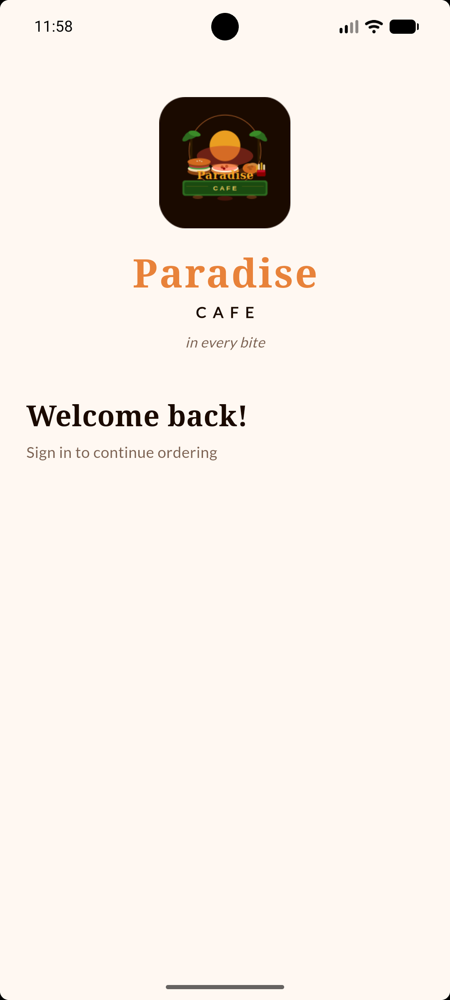 | 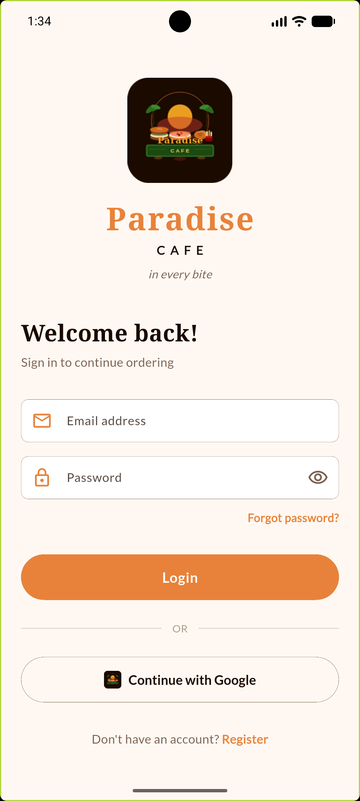 | 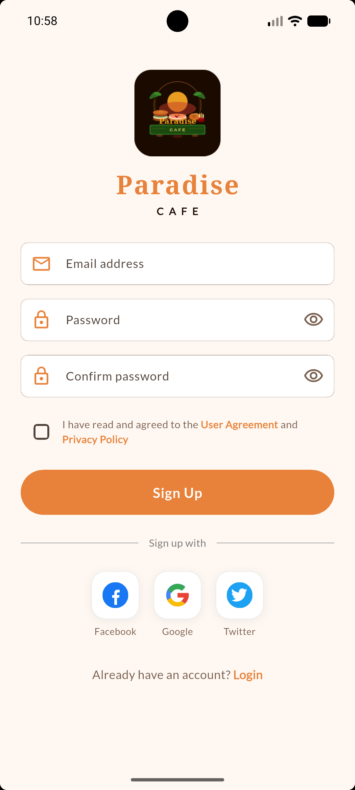 |

| Screen 4 | Screen 5 | Screen 6 |
|----------|----------|----------|
| 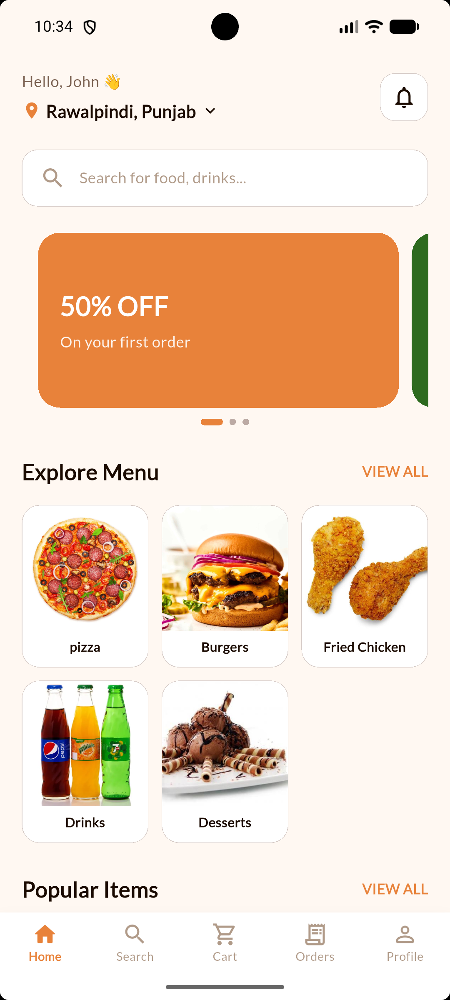 | 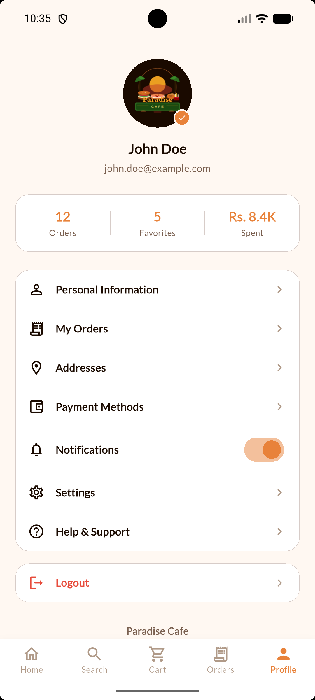 | 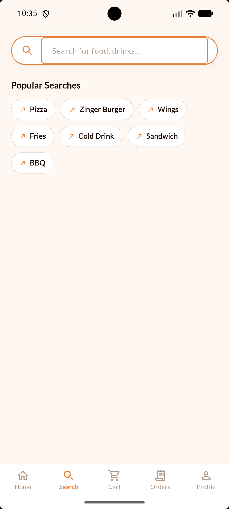 |

| Screen 7 | Screen 8 | Screen 9 |
|----------|----------|----------|
| 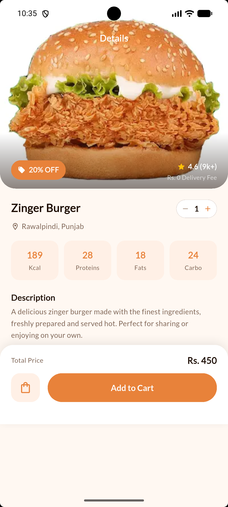 | 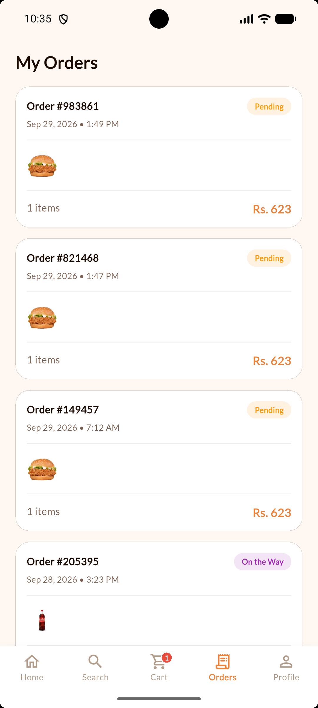 | 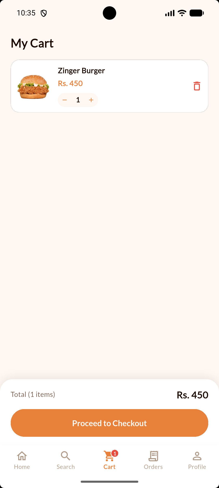 |

| Screen 10 | Screen 11 |
|-----------|-----------|
| 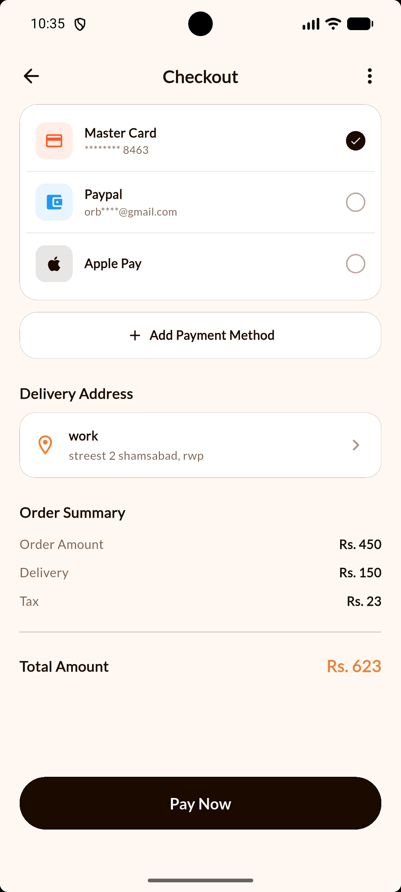 | 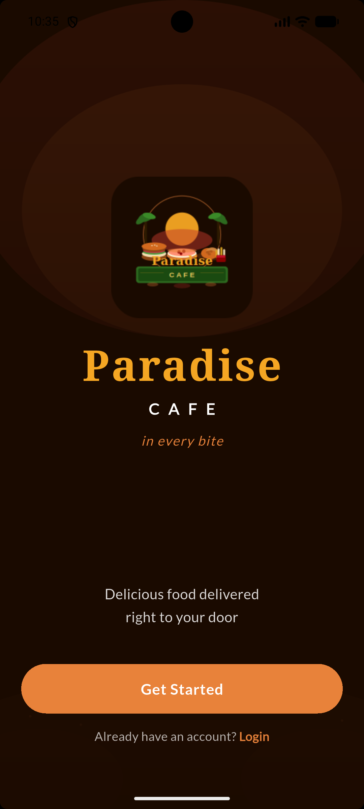 |

## ✨ Features

- 🔐 Firebase Authentication (Login, Register, Google Sign-in)
- 🛒 Real-time cart with Riverpod state management
- 📦 Order history with status tracking
- 🔍 Live search with debounce
- 🎨 Custom Paradise Cafe design system
- 🌙 Dark mode support

## 🛠️ Tech Stack

- **Framework:** Flutter & Dart
- **Backend:** Firebase (Auth, Firestore, Storage)
- **State Management:** Riverpod
- **Navigation:** Go Router
- **Local Storage:** Hive

## 🚀 Getting Started

1. Clone the repo
```bash
   git clone https://github.com/YourUsername/paradise-cafe.git
```

2. Install dependencies
```bash
   flutter pub get
```

3. Add your own `google-services.json` from Firebase Console

4. Run the app
```bash
   flutter run
```

## 👨‍💻 Developer

Sanwal — BS Information Technology, NUML Islamabad